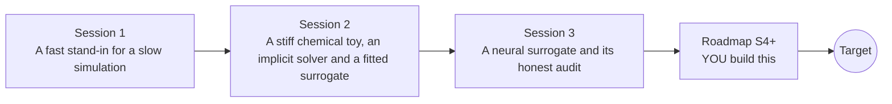

# opensurrogate

[](https://github.com/KrunalPanchal1995/opensurrogate/actions/workflows/ci.yml)   [](https://colab.research.google.com/github/KrunalPanchal1995/opensurrogate/blob/main/sessions/session-01/lesson.ipynb) [](https://krunalpanchal1995.github.io/opensurrogate/)

**Replace a slow stiff chemistry solver by a fast neural stand-in, and audit it honestly.**

opensurrogate teaches how to build and audit a neural surrogate for stiff chemical kinetics, from a lookup table to a rollout-trained network, using only Python and a browser.

- **Start from a lookup table.** Session 1 needs only school algebra: a surrogate is a fast stand-in learned from a few slow runs.
- **Stiff chemistry, no black box.** Write your own implicit solver and your own neural network with backpropagation, in plain NumPy.
- **Audit, do not just train.** Measure rollout error, mass drift, speed-up and failures; each session ends with a PASS or FAIL checkpoint.
- **Build the missing half.** The repo stops at Session 3 on purpose; the roadmap shows the path to the Target.

[Target](#the-target) · [Who is this for](#who-is-this-for) · [Quick start](#quick-start) · [Sessions](#sessions) · [Roadmap](#roadmap) · [Contribute](#contribute) · [Explainer PDF](docs/explainer.pdf)

> **This repo is incomplete on purpose.** Sessions 1 to 3 are here and fully working. The finished Target below is a preview of what the community can build next. We show you the path, not the code. Sessions 4 and up are yours.

## The Target

A held-out stiff run is solved by a reference implicit solver, then rolled forward 80 steps by two groups of neural networks. The one-step-trained group starts well and then its error band opens up and oscillates; the group trained on short rollouts stays on the true curve. A conservation panel shows one design leaking mass while the other keeps the total exactly, and a speed bar compares the solver with the surrogate. Your goal over the coming sessions: build the right-hand side yourself, then extend it to real hydrogen kinetics.


*Target: true stiff solution against surrogate rollouts, with error band, mass drift and speed-up*


*Target, final frame*


*From the author's research page: elemental mass drift of two neural kinetics models over time (early checkpoints, not converged)*


*From the author's research page: stiff H2/air ignition trajectories (reference) with two early, unconverged surrogate checkpoints*

Try it live:

- [Math Visual Studio: numerical ODE solvers and stability (Atlas S32)](https://krunalpanchal1995.github.io/studio/#atlas?ch=S32&ex=1)

How the Target was made is shown only as a path in [promo/roadmap.md](promo/roadmap.md).

## Who is this for
**higher secondary to advanced undergraduate (levels 4-6).** Topic area: Artificial Intelligence, Data Science and Robotics.

Prerequisites:

- School algebra and the idea of a graph (slope, exponential decay is explained from scratch).
- Python 3.10 or newer; if `python --version` works, you are ready. PRIMER.md explains the rest.
- No prior machine learning, chemistry or GitHub experience is needed.

New to Python? Read [PRIMER.md](PRIMER.md) first (10 minutes).

## Quick start

No installation knowledge needed. You need [Git](https://git-scm.com/downloads) and [Python 3.10+](https://www.python.org/downloads/) (Windows: tick "Add Python to PATH"). On Mac and Linux type `python3` wherever this page says `python`.

```bash
git clone https://github.com/KrunalPanchal1995/opensurrogate.git
cd opensurrogate
python start.py 1
```

`start.py` creates a private environment, installs what is needed and runs Session 1 with its checkpoint. Next: `python start.py 2`, `python start.py 3`, or `python start.py test` to check everything. Only a checkpoint: `python start.py check 1`.

Four lines turn the idea of Session 1 into a result (they work as they are): Save it as `try.py` and run it with `python start.py run try.py` (this uses the private environment, where NumPy is installed):

```python
import numpy as np
k = np.linspace(0, 5, 18)            # 18 training inputs: decay rates (1/s)
table = np.exp(-k)                   # the answers a slow simulation would give
print(round(float(np.interp(2.5, k, table)), 3))   # surrogate at k = 2.5 -> 0.083 (true 0.082)
```

Every session also opens in your browser with sliders (no install): [live apps](https://krunalpanchal1995.github.io/opensurrogate/). Or use the Colab badge above for the notebook.

## Sessions

| # | Session | Model level | Time | Live app |
|---|---|---|---|---|
| 1 | [A fast stand-in for a slow simulation](sessions/session-01/README.md) | Level 1: conceptual interactive model | 60 min | [open](https://krunalpanchal1995.github.io/opensurrogate/session-01/) |
| 2 | [A stiff chemical toy, an implicit solver and a fitted surrogate](sessions/session-02/README.md) | Level 2: mathematical engineering model | 80 min | [open](https://krunalpanchal1995.github.io/opensurrogate/session-02/) |
| 3 | [A neural surrogate and its honest audit](sessions/session-03/README.md) | Level 3: simulation and validation | 90 min | [open](https://krunalpanchal1995.github.io/opensurrogate/session-03/) |

Each session follows the same six steps: A real-world problem, B concept and theory, C visual explanation, D interactive simulation, E worked example and experiment, F assessment and design challenge. Each ends with `checkpoint.py`, which prints `PASS` or `FAIL` against reference numbers. Session 3 also contains the real-world mini-project: **Build and audit a surrogate for a stiff chain**.

## Architecture



| Folder or file | What is inside |
|---|---|
| `sessions/` | three sessions: README (A-F), `lesson.py`, notebook, live app, exercises, activity sheet, checkpoint |
| `promo/` | the Target: media, live links, and the roadmap (path only) |
| `docs/` | `explainer.tex` and the built `explainer.pdf` |
| `tests/` | runs every lesson and checkpoint headless |
| `start.py` | one command to set up and run anything |
| `QUALITY.md`, `RUBRIC.md` | the quality checklist and the scoring rubric |
| `.github/` | CI, PDF build, Pages deploy, issue and PR templates |

## Roadmap

| Milestone | What you will build | Difficulty |
|---|---|---|
| Session 4: Know when you are outside | An ensemble of five networks with a flag that raises an alarm for inputs outside the training range. | intermediate |
| Session 5: Tame the worst case | A training recipe (more rollout steps, loss weights on the fast transient, a better loss for species B) aimed at the worst case. | intermediate |
| Session 6: One network for many time steps | A network that takes dt as an extra input and works from dt = 0.5 s to 20 s. | advanced |
| Session 7: Beat the vectorised solver | A faster surrogate (smaller or batched in a smarter way) and a careful timing report. | advanced |
| Session 8: Real hydrogen kinetics and element conservation | The same pipeline for an 8-species hydrogen-oxygen mechanism, with a conservation-aware output layer for each element. | advanced |

Full detail with a checkpoint per milestone: [promo/roadmap.md](promo/roadmap.md).

## Contribute
New to GitHub? Read [CONTRIBUTING.md](CONTRIBUTING.md); it starts from zero. Pick an issue labelled `good first issue`. Translations into Hindi, Telugu, Tamil and Malayalam are welcome.

<details>
<summary>Development</summary>

```bash
python start.py test        # runs every lesson and checkpoint
```
Lessons use `# %%` cell markers so they open as notebooks in VS Code. See [QUALITY.md](QUALITY.md) for the standard every session meets.
</details>

## License
MIT. See [LICENSE](LICENSE). Media in `promo/media` is (c) Krunal Panchal, CC BY 4.0.

## Acknowledgments
Part of the [PAN IIT OSS](https://hellofoss.tech-iitb.org/projects) open-source teaching collection, modelled on the structure of [openspline](https://github.com/openspline/openspline). Built on ideas from the Math Visual Studio at https://krunalpanchal1995.github.io/studio/.
