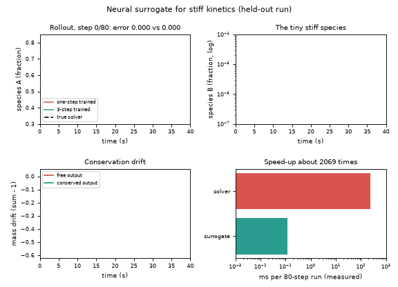
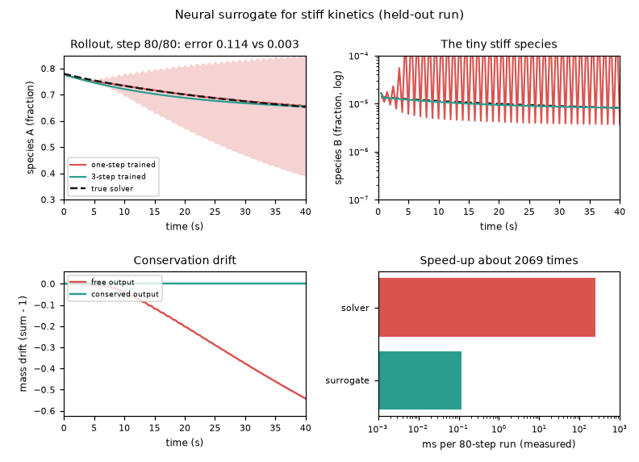
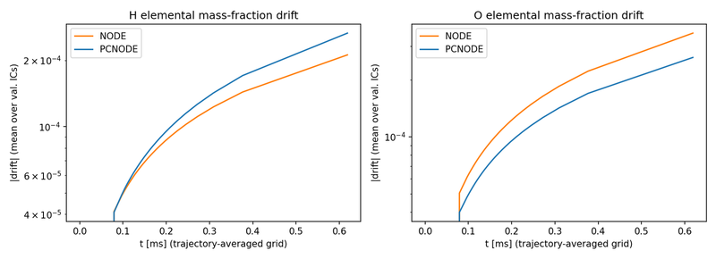
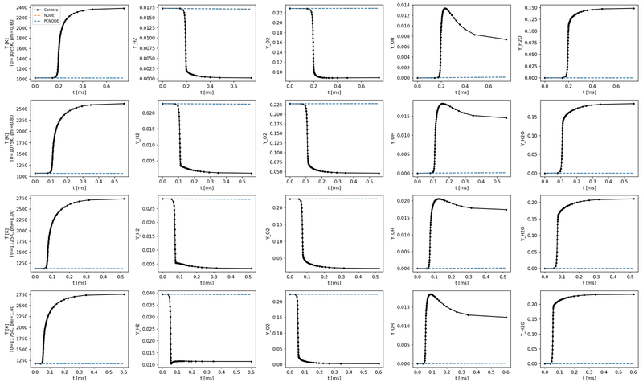

# What you are building toward

A held-out stiff run is solved by a reference implicit solver, then rolled forward 80 steps by two groups of neural networks. The one-step-trained group starts well and then its error band opens up and oscillates; the group trained on short rollouts stays on the true curve. A conservation panel shows one design leaking mass while the other keeps the total exactly, and a speed bar compares the solver with the surrogate. Your goal over the coming sessions: build the right-hand side yourself, then extend it to real hydrogen kinetics.

*Target: true stiff solution against surrogate rollouts, with error band, mass drift and speed-up*

*Target, final frame*

*From the author's research page: elemental mass drift of two neural kinetics models over time (early checkpoints, not converged)*

*From the author's research page: stiff H2/air ignition trajectories (reference) with two early, unconverged surrogate checkpoints*

These results come from a private reference build. The code is not published; the roadmap shows the path so you can build your own.

Live links:

- [Math Visual Studio: numerical ODE solvers and stability (Atlas S32)](https://krunalpanchal1995.github.io/studio/#atlas?ch=S32&ex=1)
