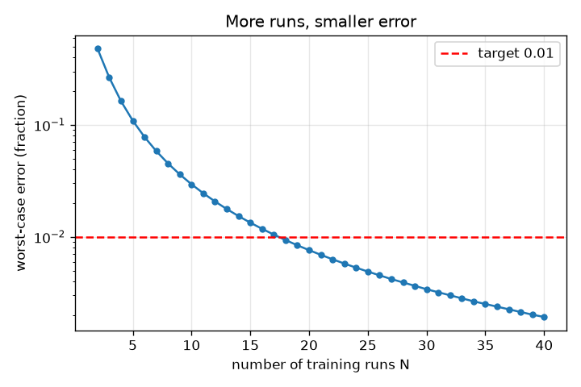
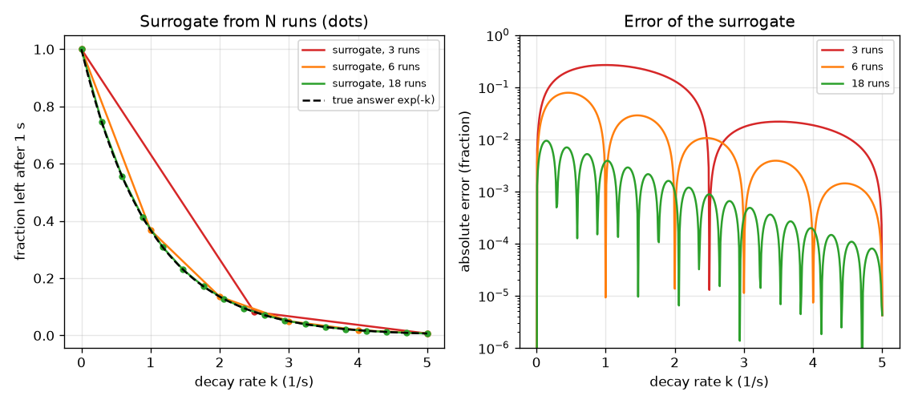

# Session 1: A fast stand-in for a slow simulation

*Level 1 (conceptual interactive model) · about 60 minutes · opensurrogate*

> This is a simplified educational model. It is not a validated design tool and must not be used for real structures, electrical installations, vehicles, industrial processes or medical decisions.

**Prerequisites**

- School algebra: reading a graph and a function f(k).
- You have read PRIMER.md and run `python start.py 1` once.

**Learning objectives.** After this session you can:

- Explain what a surrogate is: inputs in, answer out, learned from runs of a slow simulation.
- Build a lookup-table surrogate from N training runs and measure its error on new inputs.
- Read the error against the number of runs and decide how many runs are enough.
- Say why a surrogate cannot be trusted outside the inputs it was built from.

## A. Real-world problem
A combustion engineer wants the result of a chemical simulation for thousands of different conditions, but each run takes minutes. Running them all is too slow. The idea: run the slow simulation for a modest number of well-chosen conditions, learn the pattern 'conditions in, answer out', and let the learned pattern answer all the other conditions instantly. That learned pattern is called a surrogate. How many slow runs are enough, and how do we know the stand-in is good?

## B. Concept and theory
Our slow simulation follows a substance that decays at rate k (units 1/s): dy/dt = -k y, starting from y = 1, run for 1 second with 20000 tiny Euler steps. Its input is k (between 0 and 5) and its answer is the fraction left after 1 second, which is exp(-k) in exact mathematics. The surrogate is built from n training runs at evenly spaced values of k: for a new k it draws a straight line between the two nearest training runs (linear interpolation). Its error is the difference from the true answer. The worst-case error is the largest error over all k in the range. Using only the training runs and nothing else is the key limit: outside the range 0 to 5 the surrogate has no information.

| Symbol | Meaning | Unit |
|---|---|---|
| k | decay rate, the input | 1/s |
| y | fraction of the substance left after 1 s, the answer | no unit (between 0 and 1) |
| n | number of training runs | no unit |
| h | spacing between neighbouring training inputs, 5 / (n - 1) | 1/s |
| error | absolute difference between surrogate and true answer | no unit |

**Assumptions**

- The simulation is deterministic: the same k always gives the same answer.
- Only one input (k) varies; the other inputs are fixed.
- Training inputs are evenly spaced over the range 0 to 5 1/s.
- The slow simulation is accurate enough to be treated as the truth (checked against exp(-k)).

$$ \frac{dy}{dt}=-k\,y,\qquad y(0)=1\;\Rightarrow\;y(1\,\mathrm{s})=e^{-k} $$

$$ \hat y(k)=y_i+\frac{k-k_i}{k_{i+1}-k_i}\,(y_{i+1}-y_i),\qquad k_i\le k\le k_{i+1} $$

$$ \text{worst-case error}=\max_{0\le k\le 5}\left|\hat y(k)-e^{-k}\right| $$

## C. Visual explanation
The left figure draws the surrogate built from 3, 6 and 18 training runs (dots) against the true curve. With 3 runs it is a few straight pieces that miss the bend; with 18 runs the two curves are hard to tell apart. The right figure plots the error against the number of runs: it falls steeply at first and then slowly, and crosses the red target line of 0.01 at 18 runs.

*Worst-case error against the number of training runs; 18 runs are the fewest that pass the 0.01 target.*

*Surrogates from 3, 6 and 18 runs (dots) against the true curve, and their errors.*

## D. Interactive simulation
Run the lesson (`python start.py 1`), then open the live app: [Session 1: a surrogate from N runs](https://krunalpanchal1995.github.io/opensurrogate/session-01/) (or `app.html` in this folder). Move the runs slider and watch the blue surrogate bend towards the grey true curve; then open the error graph and see where the error is largest (near k = 0, where the curve bends most). Move the test k slider to read the error at one input.

**Challenge.** Reach a worst-case error below 0.01 with as few runs as possible.

## E. Worked example and experiment
**Problem.** Build the surrogate from 6 runs (k = 0, 1, 2, 3, 4, 5). What does it answer at k = 2.5, what is the true answer, and what is the error?

1. The nearest training runs are k = 2 and k = 3: exp(-2) = 0.1353 and exp(-3) = 0.0498.
2. k = 2.5 is exactly half way, so the surrogate answer is the average: (0.1353 + 0.0498) / 2 = 0.0926.
3. The true answer is exp(-2.5) = 0.0821.
4. Error = 0.0926 - 0.0821 = 0.0105 (a bit above 0.01, so 6 runs are not enough for a 0.01 target at every k).

**Answer.** The surrogate says 0.0926, the truth is 0.0821, the error is 0.0105 (about 13 percent of the answer).

**Experiment.** Run a real slow simulation in a spreadsheet or a few lines of Python: take small time steps and print the value after 1 s for k = 2 and k = 3, then for k = 2.5, and compare with the average. The same difference appears whatever the tool. Model versus reality: a real simulation would also have numerical error (here below 1e-4, checked in checkpoint.py) and many more inputs than one.

## F. Assessment and design challenge
**Question type A: Conceptual.** Why can a surrogate built from runs at k = 0 to 5 not be trusted at k = 6? What does it actually answer there?

Hint

Think about what information the training runs contain, and what np.interp does outside the table.

Step-by-step solution

The training runs say nothing about k above 5. A lookup table cannot invent information: np.interp just repeats the last value, so at k = 6 it answers 0.0067 (the value at k = 5) while the truth is 0.0025, more than twice as small. Nothing in the surrogate warns that it has left its range.

**Question type B: Numerical.** A surrogate is built from 3 runs (k = 0, 2.5, 5). Find its answer and its error at k = 1.25.

Hint

k = 1.25 is half way between the first two runs; the answers there are 1 and exp(-2.5) = 0.0821.

Step-by-step solution

Surrogate = (1 + 0.0821) / 2 = 0.541. True exp(-1.25) = 0.2865. Error = 0.541 - 0.2865 = 0.255, nearly 90 percent of the true answer: three runs are far too few where the curve bends.

**Question type C: Graph and simulation interpretation.** In the error graph, where is the error largest, and why? What happens to that peak when you add runs?

Hint

Compare the bend of exp(-k) near k = 0 and near k = 5.

Step-by-step solution

The error peaks near k = 0 where exp(-k) bends most (its second derivative is largest there); a straight line between two runs cannot follow a bend. Adding runs makes the straight pieces shorter, so the peak shrinks; with 18 runs it is 0.0094, below the 0.01 line.

**Question type D: Design and optimisation challenge.** Each slow run takes 2 minutes. Design: how many runs do you need for a worst-case error below 0.01, and below 0.001? What does the tighter target cost in time? What changes if there are two inputs on a grid with the same spacing?

Hint

Use runs_needed in the lesson, then multiply by the cost per run. For two inputs a grid needs n times n runs.

Step-by-step solution

runs_needed gives 18 runs for 0.01 (36 minutes) and 56 runs for 0.001 (112 minutes): ten times less error costs about three times more runs. With two inputs on a grid of 18 values each you need 18 x 18 = 324 runs (648 minutes) and with three inputs 5832. Trade-off: connect-the-dots wastes runs when there are several inputs, which is why Sessions 2 and 3 use fitted formulas and networks.

Score yourself with [RUBRIC.md](../../RUBRIC.md). Print the [activity sheet](activity_sheet.md) to work on paper.

## Common misconceptions
| Common misconception | What is actually true |
|---|---|
| A surrogate is the same as the simulation, just faster. | A surrogate is an approximation learned from some runs; it has an error and it only knows the inputs it was built from. |
| More runs always help the same amount. | The error falls quickly at first and then slowly (ten times less error needed about three times more runs here). |
| If the surrogate is right at the training runs, it is right everywhere. | It reproduces the training runs exactly by construction; the error is largest between them, and it is meaningless outside them. |
| If the error looks small on the plot it is small enough. | State a target (here 0.01) and measure the worst case over many test inputs, not one. |

## Glossary
- **surrogate**: a cheap learned stand-in for a slow simulation
- **training run**: one run of the slow simulation used to build the surrogate
- **interpolation**: estimating a value between known values, here by straight lines
- **worst-case error**: the largest error over all test inputs
- **extrapolation**: answering for inputs outside the range of the training runs

## Finish
1. Do the three coding tasks in [exercises.md](exercises.md).
2. Run `python start.py 1` again after your changes. It ends with the checkpoint; when it prints `PASS`, you are done. (Checkpoint only: `python start.py check 1`.)

Next: [Session 2](../session-02/README.md)
