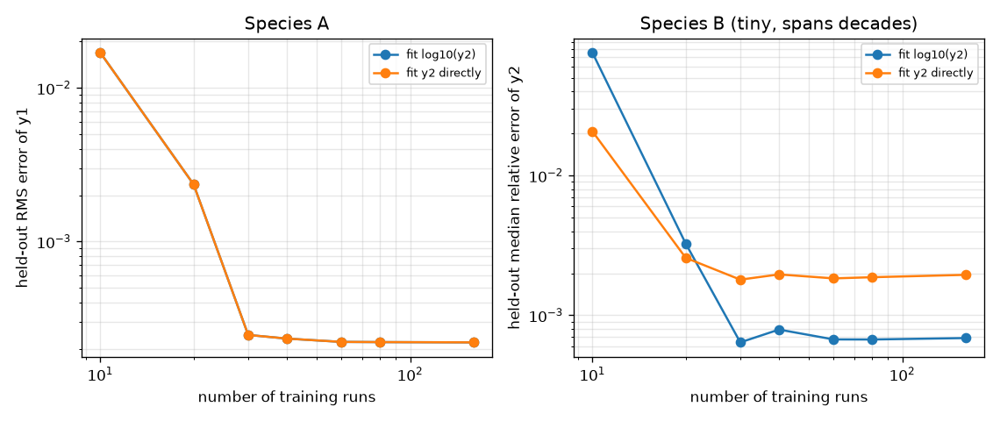
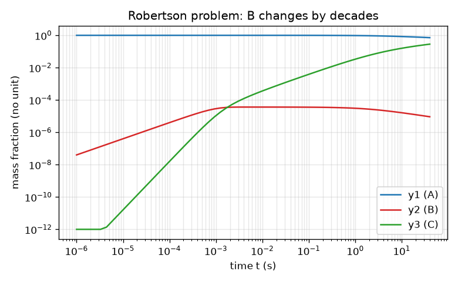

# Session 2: A stiff chemical toy, an implicit solver and a fitted surrogate

*Level 2 (mathematical engineering model) · about 80 minutes · opensurrogate*

> This is a simplified educational model. It is not a validated design tool and must not be used for real structures, electrical installations, vehicles, industrial processes or medical decisions.

**Prerequisites**

- Session 1: surrogates and held-out error.
- Derivatives as rates of change (dy/dt); matrices are explained as they appear.

**Learning objectives.** After this session you can:

- Explain stiffness: a fast reaction forces tiny steps on an explicit solver but not on an implicit one.
- Write a backward Euler solver with Newton's method and validate it on a case with an exact solution.
- Generate training data from seeded Latin hypercube runs and fit a least-squares polynomial surrogate.
- Show that log scaling helps a species that changes by decades, and size the number of training runs for a target error.

## A. Real-world problem
Chemistry inside a flame is stiff: some reactions finish in microseconds while the interesting changes take seconds. A simulation that must follow the fastest reaction with its time step becomes very expensive, and a surrogate is attractive. But first we need a trustworthy solver to produce the training data. How do you build one, how do you know it is right, and how many training runs does a surrogate need to reach a target accuracy?

## B. Concept and theory
The toy is the Robertson problem (1966), a standard stiff test with three species A, B, C (mass fractions y1, y2, y3 that always add to 1): A turns into B slowly (k1 = 0.04 per second), two B can turn one into C (k3 = 3e7), and B plus C turn back into A plus B (k2 = 1e4). The fast and slow rate constants differ by a factor of 7.5e8 (almost nine orders of magnitude). The Jacobian J (matrix of derivatives of the right-hand side) has an eigenvalue of size around a few thousand per second, so an explicit method must keep its step h below 2 divided by that, while the slow physics needs steps of seconds. Backward Euler defines the new state by y_new = y + h f(y_new) and solves this equation with Newton iterations; it is stable for every h but only first-order accurate, so we combine runs with step h and h/2 (Richardson extrapolation) to get second order. We validate on a linear chain A -> B -> C with k1 = 1 and k2 = 1e4, which has an exact solution. The surrogate maps (initial fraction y1(0), slow rate k1, time t) to the state at time t: a polynomial in these three inputs (scaled to [-1, 1], with ln t) fitted by least squares to runs drawn with a seeded Latin hypercube. Species B is about 1e-5 and varies by decades, so we fit log10(y2); the third fraction follows from y3 = 1 - y1 - y2.

| Symbol | Meaning | Unit |
|---|---|---|
| y1, y2, y3 | mass fractions of A, B, C | no unit |
| k1, k2, k3 | rate constants (k1 slow and an input; k2, k3 fast) | 1/s (fractions as units of concentration) |
| h | time step | s |
| J | Jacobian, matrix of derivatives of f with respect to y | 1/s |
| t | time at which the state is wanted (0.1 to 40) | s |
| d | total degree of the polynomial | no unit |
| R | number of training runs | no unit |

**Assumptions**

- Isothermal, constant-volume toy chemistry with mass-action rates; it is not a real fuel.
- Total mass fraction is exactly 1 at all times.
- Training inputs: y1(0) in [0.7, 1], k1 in [0.03, 0.05] per second, y2(0) = 0 and y3(0) = 1 - y1(0).
- The Richardson-extrapolated implicit solution is treated as the truth (validated on the chain and against the standard Robertson values).

$$ \dot y_1=-k_1y_1+k_2y_2y_3,\quad \dot y_2=k_1y_1-k_2y_2y_3-k_3y_2^2,\quad \dot y_3=k_3y_2^2 $$

$$ y_{n+1}=y_n+h\,f(y_{n+1}),\qquad y^{(m+1)}=y^{(m)}-\left(I-hJ\right)^{-1}\left(y^{(m)}-y_n-hf(y^{(m)})\right) $$

$$ \dot y=-k\,y:\quad y_{n+1}=(1-kh)\,y_n\ \text{(explicit)},\qquad y_{n+1}=\frac{y_n}{1+kh}\ \text{(implicit)} $$

$$ y_{\text{Richardson}}=2\,y_{h/2}-y_h \quad (\text{first-order error cancels}) $$

$$ \hat y=\Phi(x)\,c,\qquad c=\arg\min_c\|\Phi(x)c-y\|^2,\qquad x=(y_1(0),k_1,\ln t) $$

## C. Visual explanation
The first figure shows the Robertson solution on log-log axes: A and C change slowly while B jumps to about 1e-5 within a tiny fraction of a second and then declines slowly, so it changes by decades. The second figure shows the held-out error of the fitted surrogate against the number of training runs: it falls quickly up to 30 runs and then levels off at the polynomial's own limit; the log10(y2) fit gives a smaller relative error for species B than the direct fit once there are 30 or more runs.

*Held-out error against the number of training runs, with and without log scaling of species B.*

*The Robertson problem on log-log axes: species B changes by decades within the first instant.*

## D. Interactive simulation
Run the lesson (`python start.py 2`), then open the live app: [Session 2: explicit versus implicit on the fast step](https://krunalpanchal1995.github.io/opensurrogate/session-02/) (or `app.html` in this folder). Choose the fast rate k2 and the number of steps and compare explicit Euler with implicit Euler on the fast step B -> C; open the stability graph and watch the red explicit factor leave the stable zone while the blue implicit factor always stays below 1.

**Challenge.** At k2 = 10000 per second, find the smallest number of steps (over 1 ms) for which explicit Euler is stable.

## E. Worked example and experiment
**Problem.** For the fast step dy/dt = -10000 y with y(0) = 1 and a step h = 0.01 s, compute one explicit and one implicit Euler step by hand. Which one makes sense?

1. k h = 10000 x 0.01 = 100.
2. Explicit: y1 = (1 - k h) y0 = (1 - 100) x 1 = -99. The solution should lie between 0 and 1 and decay: -99 is nonsense (unstable).
3. Implicit: y1 = y0 / (1 + k h) = 1 / 101 = 0.0099. It decays, as the exact solution exp(-100) does (about 0).
4. Rule of thumb: explicit needs k h below 2, here h below 2e-4 s; implicit works for any h.

**Answer.** Explicit Euler gives -99 (unstable); implicit Euler gives 1/101 = 0.0099, which is stable and decays in the right direction.

**Experiment.** Run backward Euler and explicit Euler on dy/dt = -10000 y in a few lines of Python with h = 0.01 and h = 0.00002, and compare with exp(-k t). Expect the explicit method to blow up for the large step and to agree with the exact solution for the small one. A real chemistry code would also check the Newton iteration for convergence and use adaptive steps; our fixed grid is a simplification.

## F. Assessment and design challenge
**Question type A: Conceptual.** Why is the explicit stability limit set by the fastest reaction even when we only care about the slow behaviour afterwards?

Hint

Think about what happens to a tiny error in the fast species at each step.

Step-by-step solution

An explicit step multiplies a small error in the fast mode by (1 - k h). If k h is above 2 that factor has size above 1, so the error grows at every step and wrecks the whole solution, even though the fast species itself has long finished changing. The implicit factor 1/(1 + k h) is below 1 for every h, so the step can follow the slow physics.

**Question type B: Numerical.** For dy/dt = -2000 y and h = 0.002 s, compute k h, the explicit factor and the implicit factor. Is explicit Euler stable?

Hint

k h = 2000 x 0.002; stable means the factor has size below 1.

Step-by-step solution

k h = 4. Explicit factor 1 - 4 = -3 (size 3, unstable: it flips sign and triples each step). Implicit factor 1 / (1 + 4) = 0.2 (stable). The limit for explicit is k h below 2, i.e. h below 0.001 s.

**Question type C: Graph and simulation interpretation.** In the error graph, how does the held-out error change from 10 to 20 to 30 training runs, and why does it stop falling? Is the log fit always better?

Hint

Compare the printed numbers from lesson.py; think about the number of polynomial terms (84) and the polynomial's own limit.

Step-by-step solution

The held-out RMS error of y1 is 0.0169 with 10 runs, 0.0024 with 20 and 0.00025 with 30, then stays near 0.0002 up to 160 runs: with few runs the fit has more terms than information, and later the error is the limit of a degree-6 polynomial, not of the data. The log fit is not always better: with 10 runs the direct fit of y2 has a smaller relative error (0.021 against 0.076); from 30 runs on, the log fit wins, by a factor of about 2 to 3 at 160 runs (0.0007 against 0.0019).

**Question type D: Design and optimisation challenge.** Design: you need the held-out RMS error of y1 below 0.003, and below 0.0005. How many runs (from 10, 20, 30, ...) do you need for each? What would you change if you needed 0.0001?

Hint

Use runs_for_target(0.003) and runs_for_target(0.0005).

Step-by-step solution

20 runs reach 0.003 and 30 runs reach 0.0005. Half as many extra runs again (30 instead of 20) buys a ten times smaller error, but more runs cannot go below the plateau near 0.0002: for 0.0001 you must change the model (a higher polynomial degree or a different surrogate) rather than add runs. Assumptions: the same input ranges and a random Latin hypercube with seed 7; a different seed can move these numbers a little.

Score yourself with [RUBRIC.md](../../RUBRIC.md). Print the [activity sheet](activity_sheet.md) to work on paper.

## Common misconceptions
| Common misconception | What is actually true |
|---|---|
| Stiff means the equation is hard to write down. | Stiff means the time scales are very different, so explicit solvers need tiny steps for stability, not for accuracy. |
| An implicit method is more accurate than an explicit one. | Backward Euler is only first-order accurate; its advantage is stability. We use Richardson extrapolation to improve accuracy. |
| If the solver output looks smooth, it is correct. | Always validate on a case with an exact solution (the chain) and check conserved quantities (the fractions add to 1). |
| Fitting the raw value of a tiny species is fine. | A species that spans decades should be fitted in log scale, otherwise its relative error is poor (here about 2 to 3 times worse with 160 runs). |

## Glossary
- **stiff**: having widely different time scales, which forces tiny steps on explicit solvers
- **implicit method**: a method that defines the new state by an equation involving the new state itself
- **Newton iteration**: repeated linear solves that find the root of a nonlinear equation
- **Jacobian**: the matrix of derivatives of the right-hand side with respect to the state
- **Latin hypercube**: a sampling design that uses each slice of each input range exactly once
- **least squares**: choosing coefficients that minimise the sum of squared errors

## Finish
1. Do the three coding tasks in [exercises.md](exercises.md).
2. Run `python start.py 2` again after your changes. It ends with the checkpoint; when it prints `PASS`, you are done. (Checkpoint only: `python start.py check 2`.)

Next: [Session 3](../session-03/README.md)
