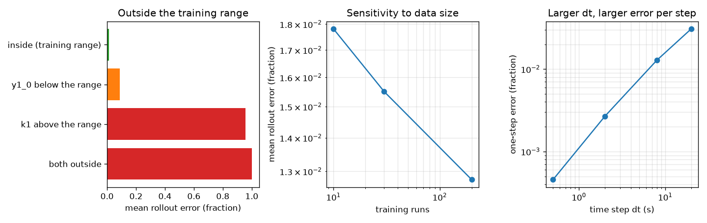
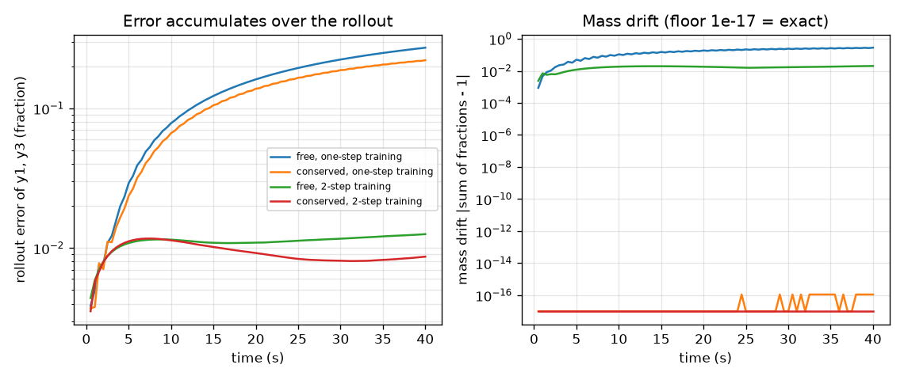
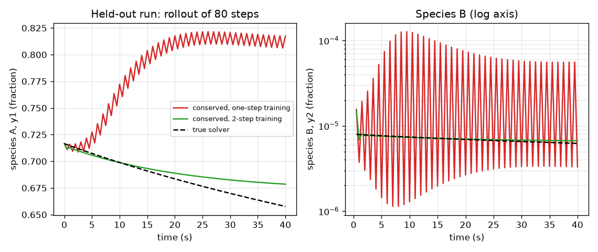

# Session 3: A neural surrogate and its honest audit

*Level 3 (simulation and validation) · about 90 minutes · opensurrogate*

> This is a simplified educational model. It is not a validated design tool and must not be used for real structures, electrical installations, vehicles, industrial processes or medical decisions.

**Prerequisites**

- Session 1: surrogates and error.
- Session 2: the Robertson problem and the implicit solver.
- Matrix products; the chain rule (explained in Section B).

**Learning objectives.** After this session you can:

- Build a small neural network with hand-coded backpropagation and Adam, and check its gradients numerically.
- Use it as a one-step surrogate, roll it out, and show how the error accumulates over the rollout.
- Remove the mass drift with a conservation-aware output, and compare one-step with multi-step training.
- Audit the surrogate: held-out validation, speed-up, extrapolation failure, data size, noise, time step.

## A. Real-world problem
Inside a large combustion simulation the chemistry is solved again and again, in every grid cell, at every time step. A neural network that jumps the chemical state forward by one time step is a candidate stand-in. But a stand-in that is almost perfect for one step can be badly wrong after eighty, can create or destroy mass, and can fail without warning outside the conditions it was trained on. Before anyone trusts it, it must be audited against the true solver. How do you do that?

## B. Concept and theory
The surrogate predicts the state after one time step dt = 0.5 s of the Robertson problem. The state is coded as z = (y1, y3, s) with s = (log10(y2 + 1e-10) + 7) / 3 (log scaling for the tiny species B). The network is a residual map z_next = z + 0.1 * net(z, k1) with two tanh hidden layers of 24 units. Backpropagation computes the gradient of the loss layer by layer with the chain rule (the derivative of tanh is 1 - h^2); Adam keeps running averages of the gradient and of its square and takes steps of size lr * m / (sqrt(v) + eps). A rollout feeds the network its own output; an error e in one step is carried into the next step, so errors accumulate. Training on several steps in a row (backpropagating through the unrolled steps) teaches the network to cope with its own errors. Conservation: a free network predicts y1, y3 and s independently, so y1 + y2 + y3 is not forced to stay 1. The conserved network predicts only y1 and s and computes y3 = 1 - y1 - y2, so the total is exactly 1. A hand-sized model shows why drift matters: if each step adds a relative error eps to a process that conserves mass, the total drifts by eps * (1 - q^n) / (1 - q) after n steps, with q the surrogate's per-step factor.

| Symbol | Meaning | Unit |
|---|---|---|
| z | coded state seen by the network | no unit |
| s | log-scaled species B | no unit |
| dt | surrogate time step (0.5) | s |
| n | number of rollout steps (80) | no unit |
| eps | relative error of the surrogate step in the toy | no unit |
| a, q | true and surrogate per-step factor in the toy (a = 0.95, q = a (1 + eps)) | no unit |
| lr | Adam learning rate | no unit |

**Assumptions**

- Three mass fractions that add to 1 (a toy; real mechanisms conserve elements, not just total mass).
- Training inputs: y1(0) in [0.7, 1], k1 in [0.03, 0.05] per second, y2(0) = 0; all test and training runs start from y2 = 0.
- The Richardson-extrapolated implicit solver is the reference.
- Timings are illustrative: they depend on the computer and on how the solver is coded.

$$ z_{j+1}=z_j+0.1\,\mathrm{net}(z_j,k_1),\qquad s=\frac{\log_{10}(y_2+10^{-10})+7}{3} $$

$$ L=\sum_{u=1}^{K}\left\|\frac{z_u-z_u^{\mathrm{true}}}{0.1}\right\|^2\quad(K=1:\ \text{one-step},\ K>1:\ \text{multi-step}) $$

$$ m\leftarrow\beta_1m+(1-\beta_1)g,\quad v\leftarrow\beta_2v+(1-\beta_2)g^2,\quad \theta\leftarrow\theta-\mathrm{lr}\,\frac{m/(1-\beta_1^t)}{\sqrt{v/(1-\beta_2^t)}+\epsilon} $$

$$ y_3=1-y_1-y_2\quad(\text{conserved output}) $$

$$ \text{drift}_n=\epsilon\,\frac{1-q^{n}}{1-q},\qquad q=a(1+\epsilon) $$

## C. Visual explanation
The first figure follows one held-out run for 80 steps: the surrogate trained on single steps (red) departs from the true solver (dashed) while the surrogate trained on two-step rollouts (green) stays on it; the right panel shows species B on a log axis. The second figure plots the rollout error on a log axis (it grows for one-step training and stays flat for multi-step training) and the mass drift (the free network leaks mass; the conserved network does not). The third figure is the audit: error outside the training range, sensitivity to the number of training runs, and the growth of the one-step error with the time step.

*The audit: error outside the training range, sensitivity to data size, and one-step error against the time step.*

*Rollout error and mass drift for free and conserved networks with one-step and 2-step training.*

*One held-out run: true solver against one-step-trained and 2-step-trained conserved surrogates (species A, and species B on a log axis).*

## D. Interactive simulation
Run the lesson (`python start.py 3`), then open the live app: [Session 3: rollout error and mass drift in a toy](https://krunalpanchal1995.github.io/opensurrogate/session-03/) (or `app.html` in this folder). In the toy rollout, set the per-step error eps and the number of steps, and watch the error band around species A open up; open the mass view and switch the conserved output on and off.

**Challenge.** Keep the mass drift below 1 percent for at least 100 steps with eps = 2 percent (or find the largest eps that does it without conservation).

## E. Worked example and experiment
**Problem.** In the toy model (a = 0.95 per step, relative step error eps = 2 percent) compute the true A, the surrogate A and the total-mass drift after 50 steps, with a free output.

1. True A = 0.95^50 = 0.0769.
2. Surrogate factor q = 0.95 x 1.02 = 0.969, so surrogate A = 0.969^50 = 0.2071 (almost three times too large).
3. Each step adds eps x A of mass, so drift = eps (1 - q^50) / (1 - q) = 0.02 x (1 - 0.2071) / 0.031 = 0.512.
4. The free network has created 51 percent more mass than exists; a conserved output computes B = 1 - A and has drift exactly 0.

**Answer.** True A 0.0769, surrogate A 0.2071, drift 0.512 for the free output and 0 for the conserved output.

**Experiment.** Run the toy in toy_rollout (or by hand in a spreadsheet): 50 rows with A(j+1) = 0.969 A(j) and B(j+1) = B(j) + 0.051 A(j), and add the columns. Then try the real networks: the free network leaks mass at the same kind of rate. Model versus reality: the toy has a fixed relative error; a real network's error depends on the state, and the true system is stiff, so errors can also be damped or amplified by the dynamics.

## Real-world application and mini-project: Build and audit a surrogate for a stiff chain
You are given the stiff three-species chain A -> B -> C with k1 = 1 per second and k2 = 1e4 per second (it has an exact solution, `chain_exact` in Session 2). Build a one-step neural surrogate with your own data (use `chain_rhs` and the backward Euler solver), roll it out, and audit it against the exact solution. Use the Session 3 network code: only the right-hand side and the data change.

**Deliverable:** A script that prints (1) the one-step error and the rollout error at the last step on held-out initial conditions, (2) the mass drift with and without a conserved output, (3) the measured speed-up over your solver, and (4) the worst-case error on a test set outside the training range, plus one figure with the exact solution and the surrogate rollout.

**Success looks like:** The conserved surrogate keeps the total mass to 1e-12, the held-out rollout error stays below 0.02 for every step, the speed-up is reported with the timing method, and the out-of-range error is reported and larger than the in-range error (it is not hidden).

## F. Assessment and design challenge
**Question type A: Conceptual.** A surrogate has a one-step error of 0.0005 but a rollout error of 0.2 after 80 steps. How is that possible, and what two remedies does this session test?

Hint

Where do the inputs of step 2 come from?

Step-by-step solution

The one-step error is measured from the TRUE state. In a rollout the network's own, slightly wrong output becomes the input of the next step, a state it never saw in training, so its error is bigger there and the errors compound. Remedy 1: train on several steps in a row (multi-step training), which reduces the step-80 error from 0.22 to 0.009. Remedy 2: for mass, build the conservation into the output layer (y3 = 1 - y1 - y2), which removes the drift exactly.

**Question type B: Numerical.** In the toy with a = 0.95 and eps = 1 percent, how much mass has been created after 100 steps with a free output? What if the output were conserved?

Hint

drift = eps (1 - q^n) / (1 - q) with q = 0.95 x 1.01.

Step-by-step solution

q = 0.9595, q^100 = 0.0156, so drift = 0.01 x (1 - 0.0156) / 0.0405 = 0.243: 24 percent extra mass. With a conserved output the drift is exactly 0. Sanity check: eps = 2 percent gives 0.617, so the drift is roughly proportional to eps.

**Question type C: Graph and simulation interpretation.** In the error figure, compare the one-step-trained and the 2-step-trained conserved networks. What do the curves say about error growth and about the mass drift of each?

Hint

Read the values at step 80 from lesson.py: the y1/y3 error and the mass drift.

Step-by-step solution

The one-step-trained rollout error grows from 0.004 at step 1 to 0.22 at step 80; the 2-step-trained one is 0.0035 at step 1 and 0.009 at step 80, flat after step 10. Both conserved networks have mass drift 1e-16 (zero up to rounding), while the free one-step network has drifted by 0.28 and the free 2-step network by 0.02: multi-step training lowers the drift but only the structure removes it.

**Question type D: Design and optimisation challenge.** Design: you must deliver a surrogate with every held-out y1 error below 0.06 over 80 steps, mass drift below 1e-12, and a measured speed-up of at least 50 times over a one-at-a-time solver. Which options from this session do you choose, and which would you avoid? Justify with the numbers.

Hint

Use the conserved/free, one-step/multi-step comparison, the speed test and the extrapolation test.

Step-by-step solution

Choose a conserved output with 2-step training: its worst y1 error over 100 held-out runs is 0.056, its mass drift is 1e-16 and it is more than 50 times faster than the solver run one at a time (hundreds of times in our timings). Avoid one-step training (error 0.22) and a free output (drift 0.28). Trade-offs: the speed-up against a vectorised solver is only a few times; and the guarantee is only for inputs inside the training range, where the error is 0.012; outside (k1 above the range) it is 0.96, so the deliverable needs a stated validity range.

Score yourself with [RUBRIC.md](../../RUBRIC.md). Print the [activity sheet](activity_sheet.md) to work on paper.

## Common misconceptions
| Common misconception | What is actually true |
|---|---|
| A small one-step error means a good rollout. | Errors are fed back as inputs; a one-step error of 0.0005 grew to 0.22 over 80 steps. |
| A neural network learns physics such as conservation by itself. | The free network created or destroyed mass; conservation must be built in or enforced. |
| If the surrogate looks good on held-out runs it is good everywhere. | Held-out runs from the same range test interpolation only; outside the range the error was 0.96 here, with no warning. |
| Speed-up is a single number. | It depends on what you compare with: here hundreds of times against a one-at-a-time solver but only a few times against a vectorised solver. |
| More training data always fixes the error. | Data size had a modest effect here (0.018 with 10 runs, 0.013 with 200); the design of the model and the training (multi-step, conserved output) mattered far more. |

## Glossary
- **rollout**: feeding a model's own output back as the next input, step after step
- **backpropagation**: applying the chain rule layer by layer to get the gradient of the loss
- **Adam**: a gradient method with running averages of the gradient and its square
- **residual network**: a network that predicts the change of the state, not the state
- **drift**: slow loss or gain of a quantity that should be conserved
- **extrapolation**: using the model outside the range of its training data

## Finish
1. Do the three coding tasks in [exercises.md](exercises.md).
2. Run `python start.py 3` again after your changes. It ends with the checkpoint; when it prints `PASS`, you are done. (Checkpoint only: `python start.py check 3`.)

Next: the [roadmap](../../promo/roadmap.md). Session 4 is yours to build.
